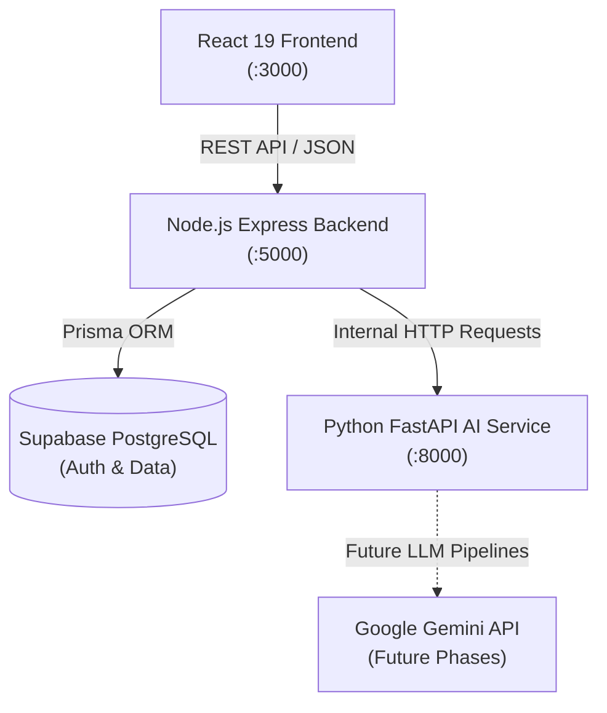

# EventPilot AI — Intelligent Event Planning & Celebration Platform

<p align="center">
  <strong>Transforming celebrations through personalized AI planning, adaptive budget optimization, and community vendor curation.</strong>
</p>

---

## 1. Project Overview

**EventPilot AI** is an intelligent, full-stack event and celebration planning platform. Whether organizing weddings, milestone anniversaries, birthday galas, corporate gatherings, or community festivals, EventPilot AI equips planners with intelligent tooling:

- **AI Co-Pilot**: Conversational event guidance that answers budget, vendor, and checklist queries.
- **Adaptive Re-Planning Engine**: Real-time simulation and optimization when guest counts or financial allocations change.
- **Smart Budget Allocator**: Dynamic expense category breakdown with live variance tracking.
- **Curated Community Vendor Network**: Community-submitted, price-benchmarked venue and vendor ratings.
- **Intelligent Checklists**: Priority-driven, milestone-aware task management.

---

## 2. Technology Stack

### Frontend Application
- **Framework**: React 19 + TypeScript + Vite
- **Styling**: Tailwind CSS v4, Lucide Icons
- **State Management**: Zustand
- **Animations & Visualizations**: Motion (Framer Motion), Recharts, Canvas Confetti

### Main Backend
- **Runtime & Server**: Node.js (v18+) + Express.js + TypeScript
- **Database**: Supabase PostgreSQL
- **ORM & Migrations**: Prisma ORM
- **Validation & Security**: Zod, Helmet, CORS, dotenv
- **Structured Logging**: Pino, pino-http
- **Testing**: Vitest, Supertest

### AI Microservice
- **Runtime**: Python 3.11+
- **Framework**: FastAPI, Pydantic v2, Uvicorn, HTTPX
- **Testing**: pytest, pytest-asyncio, FastAPI TestClient

### Infrastructure & Orchestration
- **Containers**: Docker, Docker Compose
- **Deployment Targets**: Render, Railway, Cloud Run compatible
- **Version Control**: Git, GitHub

---

## 3. Architecture Overview



---

## 4. Repository Structure

```
EventPilot-AI/
├── src/                    # Existing React 19 frontend application
│   ├── components/         # UI components (adaptive planning, layout, AI)
│   ├── pages/              # Views (Dashboard, Budget, Timeline, Guests, Vendors)
│   ├── services/           # Frontend mock data and simulation services
│   ├── store/              # Zustand global application state store
│   └── types/              # Domain TypeScript interfaces
├── backend/                # Node.js + Express + Prisma backend service
│   ├── prisma/             # Database schema (UserProfile & Event models)
│   ├── src/
│   │   ├── config/         # Zod env validation, Prisma singleton, Pino logger
│   │   ├── controllers/    # Route controllers (HealthController)
│   │   ├── middleware/     # Request logger, 404 handler, centralized error handler
│   │   ├── routes/         # Express routers (health.routes.ts)
│   │   ├── services/       # Domain business services (HealthService)
│   │   ├── utils/          # Standard ApiResponse and ApiError utilities
│   │   ├── app.ts          # Express application factory (decoupled for testing)
│   │   └── server.ts       # Server listener with graceful shutdown
│   ├── tests/              # Vitest + Supertest integration tests
│   ├── docs/               # In-depth backend documentation
│   ├── .env.example        # Backend environment template
│   ├── Dockerfile          # Production multi-stage Docker container
│   ├── package.json        # Dependencies and scripts
│   ├── tsconfig.json       # TypeScript configuration
│   └── vitest.config.ts    # Vitest runner configuration
├── ai-service/             # Python 3.11+ FastAPI microservice
│   ├── app/
│   │   ├── config.py       # Pydantic Settings & environment validation
│   │   ├── main.py         # FastAPI application entrypoint
│   │   └── routes/         # API routes (health.py)
│   ├── tests/              # Pytest test suite with TestClient
│   ├── docs/               # AI service documentation
│   ├── requirements.txt    # Pinned Python dependencies
│   ├── .env.example        # Environment variable template
│   └── Dockerfile          # Python production Docker container
├── docs/                   # Monorepo architecture & roadmap
│   ├── PROJECT_ARCHITECTURE.md
│   ├── BACKEND_ROADMAP.md
│   └── DEVELOPMENT_WORKFLOW.md
├── docker-compose.yml      # Local multi-service orchestration
├── .gitignore              # Repository git ignore rules
└── README.md               # Root repository guide
```

---

## 5. Prerequisites

Before running the project locally, ensure you have installed:
- **Node.js**: `v18.0.0` or higher (`v22` recommended)
- **npm**: `v9.0.0` or higher
- **Python**: `3.11` or higher
- **Docker & Docker Compose**: (Optional, for containerized workflows)

---

## 6. Installation & Local Development

### Step 1: Clone the Repository
```bash
git clone https://github.com/ZEESHAN0603/PromptWar.git
cd PromptWar
```

### Step 2: Set Up the Frontend
```bash
# Install frontend dependencies
npm install

# Start frontend development server on port 3000
npm run dev
```

### Step 3: Set Up the Node.js Backend
```bash
cd backend

# Install backend dependencies
npm install

# Copy environment variables
cp .env.example .env

# Validate Prisma schema and generate client
npm run prisma:generate

# Start backend server on port 5000
npm run dev
```

### Step 4: Set Up the Python AI Service
```bash
cd ai-service

# Install Python requirements
python -m pip install -r requirements.txt

# Copy environment variables
cp .env.example .env

# Start FastAPI service on port 8000
uvicorn app.main:app --reload --port 8000
```

---

## 7. Running with Docker Compose

To start both the Node.js backend and Python AI microservice with a single command:
```bash
docker compose up --build
```
- Node.js Backend: [http://localhost:5000](http://localhost:5000)
- Python AI Microservice: [http://localhost:8000](http://localhost:8000)
- Interactive AI Docs (Swagger): [http://localhost:8000/docs](http://localhost:8000/docs)

To stop services:
```bash
docker compose down
```

---

## 8. Automated Testing

### Backend Tests (Node.js / Vitest / Supertest)
```bash
cd backend
npm run test
```
Runs 17 automated tests covering:
- Health check endpoints (`/api/health`, `/api/health/db`, `/api/health/detailed`)
- Zod environment parsing and security redaction
- Operational vs. internal error handling shapes
- Database connection degradation handling

### Python AI Service Tests (pytest)
```bash
cd ai-service
python -m pytest tests/ -v
```
Runs test cases verifying application initialization, health responses, 404 routing, and Pydantic configuration validation.

### Frontend Quality Check
```bash
npm run lint
npm run build
```

---

## 9. Current Implementation Status & Roadmap

| Phase | Description | Status |
|---|---|---|
| **Phase 1** | **Backend Foundation, Supabase/Prisma Setup, AI Scaffold, Tests & Docs** | **✅ Completed** |
| Phase 2 | Authentication & Event Management | ⏳ Planned |
| Phase 3 | Budget, Guests & Timeline | ⏳ Planned |
| Phase 4 | Community Vendor Recommendation System | ⏳ Planned |
| Phase 5 | Personalized Ideas AI (Gemini Integration) | ⏳ Planned |
| Phase 6 | Adaptive Re-Planning Engine | ⏳ Planned |
| Phase 7 | AI Co-Pilot (Interactive Assistance) | ⏳ Planned |

For the complete multi-phase architecture and details, see [`docs/BACKEND_ROADMAP.md`](docs/BACKEND_ROADMAP.md).

---

## 10. Git Commands

Use selective staging when collaborating or contributing:

```bash
git status
git add backend/ ai-service/ docs/ docker-compose.yml .gitignore README.md
git commit -m "feat(backend): initialize EventPilot AI backend foundation"
git push origin <branch-name>
```
