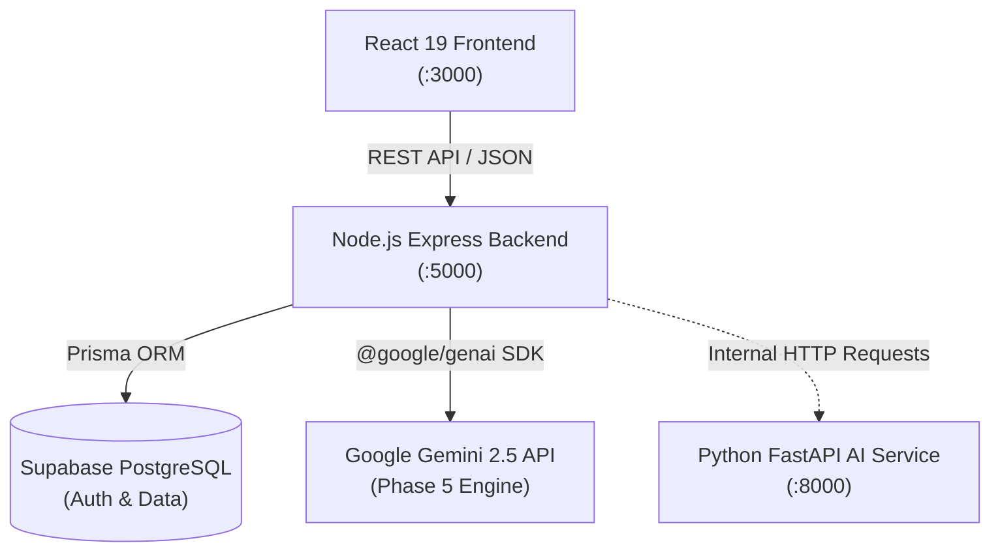

# EventPilot AI — Intelligent Event Planning & Celebration Platform

<p align="center">
  <strong>Transforming celebrations through personalized AI planning, adaptive budget optimization, and community vendor curation.</strong>
</p>

---

## 1. Project Overview

**EventPilot AI** is an intelligent celebration and event planning platform. Whether organizing weddings, milestone anniversaries, birthday galas, corporate gatherings, or community festivals, EventPilot AI equips planners with intelligent tooling:

- **AI Co-Pilot**: Conversational event guidance that answers budget, vendor, and checklist queries.
- **Adaptive Re-Planning Engine**: Real-time simulation and optimization when guest counts or financial allocations change.
- **Smart Budget Allocator**: Dynamic expense category breakdown with live variance tracking.
- **Curated Community Vendor Network**: Community-submitted, price-benchmarked venue and vendor ratings.
- **Intelligent Checklists**: Priority-driven, milestone-aware task management.

---

## 2. Technology Stack

### Frontend Application
- **Framework**: React 19 + TypeScript + Vite
- **Styling**: Tailwind CSS v4, Lucide Icons
- **State Management**: Zustand
- **Visualizations**: Recharts, Canvas Confetti, Motion

### Main Backend
- **Runtime & Server**: Node.js (v18+) + Express.js + TypeScript
- **Database**: Supabase PostgreSQL (Exclusively)
- **ORM & Migrations**: Prisma ORM
- **Validation & Security**: Zod, Helmet, CORS, dotenv
- **Structured Logging**: Pino, pino-http
- **Testing**: Vitest, Supertest

### AI Microservice
- **Runtime**: Python 3.11+
- **Framework**: FastAPI, Pydantic v2, Uvicorn, HTTPX
- **Testing**: pytest, pytest-asyncio, FastAPI TestClient

---

## 3. Architecture Overview



---

## 4. Repository Structure

```
EventPilot-AI/
├── src/                    # Existing React 19 frontend application
│   ├── components/         # UI components (adaptive planning, layout, AI)
│   ├── pages/              # Views (Dashboard, Budget, Timeline, Guests, Vendors)
│   ├── services/           # Frontend mock data and simulation services
│   ├── store/              # Zustand global application state store
│   └── types/              # Domain TypeScript interfaces
├── backend/                # Node.js + Express + Prisma backend service
│   ├── prisma/             # Schema & migrations (Profile, Event, Budget, Expense, Guest, Task, Timeline)
│   ├── src/
│   │   ├── config/         # Zod env validation, Prisma singleton, Pino logger, Supabase client
│   │   ├── controllers/    # Route controllers (user, event, budget, guest, task, timeline, health)
│   │   ├── middleware/     # Auth JWT verification, request logger, error handling
│   │   ├── routes/         # Express routers (users, events, budget, guests, tasks, timeline, health)
│   │   ├── services/       # Domain business services with ownership guards & BFS cycle detection
│   │   ├── validators/     # Zod request validators for events, users, budget, guests, tasks, timeline
│   │   ├── utils/          # Standard ApiResponse, ApiError, route param helpers
│   │   ├── app.ts          # Express application factory (decoupled for testing)
│   │   └── server.ts       # Server listener with graceful shutdown
│   ├── tests/              # Vitest + Supertest integration tests (13 suites, 112 tests)
│   ├── docs/               # In-depth backend documentation
│   ├── .env.example        # Backend environment template
│   ├── .gitignore          # Backend git ignore rules
│   ├── package.json        # Dependencies and scripts
│   ├── tsconfig.json       # TypeScript configuration
│   └── vitest.config.ts    # Vitest runner configuration
├── ai-service/             # Python 3.11+ FastAPI microservice
│   ├── app/
│   │   ├── config.py       # Pydantic Settings & environment validation
│   │   ├── main.py         # FastAPI application entrypoint
│   │   └── routes/         # API routes (health.py)
│   ├── tests/              # Pytest test suite with TestClient
│   ├── docs/               # AI service documentation
│   ├── requirements.txt    # Pinned Python dependencies
│   └── .env.example        # Environment variable template
├── docs/                   # Monorepo architecture & roadmap
│   ├── PROJECT_ARCHITECTURE.md
│   ├── BACKEND_ROADMAP.md
│   └── DEVELOPMENT_WORKFLOW.md
├── .gitignore              # Repository git ignore rules
└── README.md               # Root repository guide
```

---

## 5. Prerequisites

Before running the project locally, ensure you have:
- **Node.js**: `v18.0.0` or higher (`v22` recommended)
- **npm**: `v9.0.0` or higher
- **Python**: `3.11` or higher
- **Supabase Project**: An active Supabase PostgreSQL database project (no local PostgreSQL required)

---

## 6. Installation & Local Development

### Step 1: Set Up the Frontend
```bash
# Install frontend dependencies
npm install

# Start frontend development server on port 3000
npm run dev
```

### Step 2: Set Up the Node.js Backend
```bash
cd backend

# Install backend dependencies
npm install

# Copy environment variables
cp .env.example .env

# Validate Prisma schema and generate client
npm run prisma:validate
npm run prisma:generate

# Start backend server on port 5000
npm run dev
```

### Step 3: Set Up the Python AI Service
```bash
cd ai-service

# Install Python requirements
python -m pip install -r requirements.txt

# Copy environment variables
cp .env.example .env

# Start FastAPI service on port 8000
uvicorn app.main:app --reload --port 8000
```

---

## 7. Environment Configuration

### Backend (`backend/.env`)
- `PORT`: Port on which Express server listens (default: `5000`).
- `NODE_ENV`: Runtime environment (`development`, `production`, `test`).
- `FRONTEND_URL`: Allowed CORS origin (default: `http://localhost:3000`).
- `DATABASE_URL`: Supabase connection pooling URI (port `6543`).
- `DIRECT_URL`: Supabase direct connection URI (port `5432`).
- `SUPABASE_URL`: Supabase project URL.
- `SUPABASE_ANON_KEY`: Supabase anon/public key.
- `SUPABASE_SERVICE_ROLE_KEY`: Supabase service role key (backend only).
- `JWT_SECRET`: Supabase JWT secret.
- `AI_SERVICE_URL`: URL to internal Python microservice (default: `http://localhost:8000`).

### AI Service (`ai-service/.env`)
- `ENVIRONMENT`: `development` or `production`.
- `PORT`: AI service port (default: `8000`).
- `HOST`: Bind host (default: `0.0.0.0`).
- `INTERNAL_API_SECRET`: Shared secret for backend-to-AI requests.
- `BACKEND_INTERNAL_URL`: URL pointing to the Express backend.

---

## 8. Automated Testing

### Backend Tests (Node.js / Vitest / Supertest)
```bash
npm --prefix backend test
```
Tests:
- Health check endpoints (`/api/health`, `/api/health/db`, `/api/health/detailed`)
- Zod environment parsing and secret masking
- Operational vs. internal error handling shapes
- Database connection failure and degradation handling
- Authentication middleware and token validation
- User profile provisioning and management
- Event CRUD, pagination, filtering, and cross-tenant data isolation
- Budget categories, expenses, variance, and warning alerts
- Guest management, RSVP tracking, and plus-one headcount aggregation
- Task management, due date sorting, and BFS dependency cycle detection
- Event timeline run-of-show and chronological validation
- Community vendor recommendation, duplicate check, and contributions
- AI celebration idea synthesis with Gemini, category filtering, and favorite persistence
- **Status: 13 test files, 112/112 passing tests (100% pass rate)**

### Python AI Service Tests (pytest)
```bash
cd ai-service
python -m pytest tests/ -v
```
Tests application initialization, `/health` response structure, 404 routing, and configuration constraints (**4/4 passing tests**).

### Frontend Quality Check
```bash
npm run lint
npm run build
```

---

## 9. Troubleshooting

- **Prisma Error P1012**: Ensure `DATABASE_URL` and `DIRECT_URL` are set in `backend/.env`.
- **Database 503 on `/api/health/db`**: Verify Supabase connection string and project status.
- **Port Conflict**: Modify `PORT` in `backend/.env` or `ai-service/.env`.
- **Gemini API Error**: Ensure `GEMINI_API_KEY` is configured in `backend/.env` for Phase 5 idea generation.

---

## 10. Current Implementation Status & Roadmap

| Phase | Description | Status |
|---|---|---|
| **Phase 1** | **Backend Foundation, Supabase/Prisma Setup, AI Scaffold, Tests & Docs** | **✅ Completed** |
| **Phase 2** | **Authentication, User Profiles & Event Management CRUD** | **✅ Completed** |
| **Phase 3** | **Event Planning: Budget, Expenses, Guests, Tasks & Timeline** | **✅ Completed** |
| **Phase 4** | **Community Vendor Recommendation System & Moderation** | **✅ Completed** |
| **Phase 5** | **Personalized Celebration Ideas AI (Google Gemini 2.5 Integration)** | **✅ Completed** |
| Phase 6 | Adaptive Re-Planning Engine | ⏳ Planned |
| Phase 7 | AI Co-Pilot (Interactive Assistance) | ⏳ Planned |

For the complete multi-phase architecture and details, see [`docs/BACKEND_ROADMAP.md`](docs/BACKEND_ROADMAP.md).

---

## 11. Implemented Features & Core API Surface

### Phase 5: Personalized Ideas AI (Gemini Engine)
- `POST /api/events/:eventId/ideas/generate` — Synthesize personalized celebration concepts via Gemini with rate limiting & Zod validation
- `GET /api/events/:eventId/ideas` — Retrieve celebration ideas with category & saved filters
- `GET /api/events/:eventId/ideas/:id` — Retrieve single personalized concept
- `POST /api/events/:eventId/ideas/:id/save` — Save idea to favorites
- `DELETE /api/events/:eventId/ideas/:id/save` — Remove idea from favorites
- `DELETE /api/events/:eventId/ideas/:id` — Delete celebration idea with ownership verification
- `PATCH /api/events/:eventId/ideas/:id/toggle-save` — Toggle saved status (backward compatibility)

### Phase 4: Community Vendor Recommendation System
- `GET /api/vendors` — Public discovery of approved community vendors
- `GET /api/vendors/:id` — Vendor details by UUID
- `GET /api/vendors/check-duplicates` — Duplicate vendor prevention
- `POST /api/vendors/contributions` — Submit community vendor contribution with consent validation
- `GET /api/users/me/saved-vendors` — User's saved vendor bookmarks
- `GET /api/events/:eventId/vendor-recommendations` — Transparent deterministic recommendation engine (0-100 pts)
- `GET, POST, PATCH, DELETE /api/events/:eventId/vendors` — Event vendor workspace team assignments

### Phase 3: Budget, Expenses, Guests, Tasks & Timeline
- `POST, GET, PATCH, DELETE /api/events/:eventId/budget/categories` — Budget category allocations
- `POST, GET, PATCH, DELETE /api/events/:eventId/budget/expenses` — Expense voucher tracking
- `GET /api/events/:eventId/budget/summary` — Budget health, utilization, variance, and warning alerts
- `POST, GET, PATCH, DELETE /api/events/:eventId/guests` — Guest list & RSVP management
- `GET /api/events/:eventId/guests/summary/stats` — Attendee & plus-one aggregation
- `POST, GET, PATCH, DELETE /api/events/:eventId/tasks` — Tasks with BFS cycle-detected dependencies
- `POST, GET, PATCH, DELETE /api/events/:eventId/timeline` — Chronological run-of-show milestones

---

## 12. Documentation Links
- [`docs/phase-5-completion.md`](docs/phase-5-completion.md) — Phase 5 completion report (Personalized Ideas Engine)
- [`docs/phase-4-completion.md`](docs/phase-4-completion.md) — Phase 4 completion report (Vendor System)
- [`docs/phase-3-completion.md`](docs/phase-3-completion.md) — Phase 3 completion report (Event Planning)
- [`docs/phase-2-completion.md`](docs/phase-2-completion.md) — Phase 2 completion report (Auth & Events)
- [`docs/architecture.md`](docs/architecture.md) — System architecture & request flow
- [`docs/api-reference.md`](docs/api-reference.md) — Detailed endpoint reference (Phases 1-5)
- [`docs/database-design.md`](docs/database-design.md) — Database schema, ER diagram, and indexes
- [`docs/authentication.md`](docs/authentication.md) — Supabase Auth and JWT verification
- [`docs/testing.md`](docs/testing.md) — Test strategies & execution reports (112 tests)
