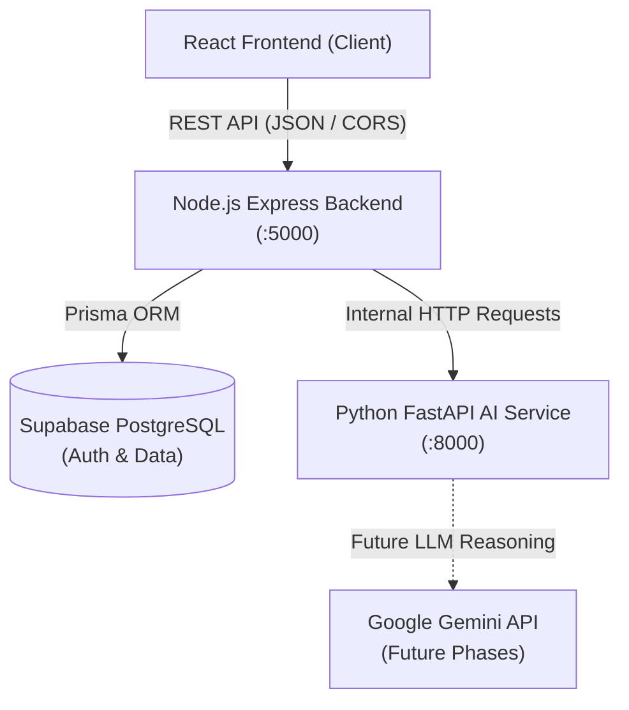

# EventPilot AI — Backend Architecture

## Overview

The EventPilot AI backend is designed as a modular, scalable Node.js service using Express.js and TypeScript, connected to Supabase PostgreSQL via Prisma ORM.

---

## Core Principles

1. **Separation of Concerns**: Application definition (`app.ts`) is cleanly decoupled from network server lifecycle (`server.ts`), allowing fast and isolated integration testing via Supertest without occupying network ports.
2. **Fail-Fast Environment Validation**: Zod parses all environment variables at startup. If any critical variable is absent or invalid, the process halts immediately with descriptive error messages. Secrets are redacted from logs.
3. **Unified API Contract**: Every endpoint responds with standard payload formats (`ApiResponse` and `ApiError`), ensuring frontend predictability.
4. **Resilient Database Layer**: Database health is verified using lightweight non-blocking queries and connection pooling. The API never reports healthy if the database connection fails.
5. **Security by Default**: Helmet secures HTTP headers, CORS is strictly enforced for approved origins, body parser limits protect against DOS attacks, and sensitive data paths are masked in structured Pino logs.

