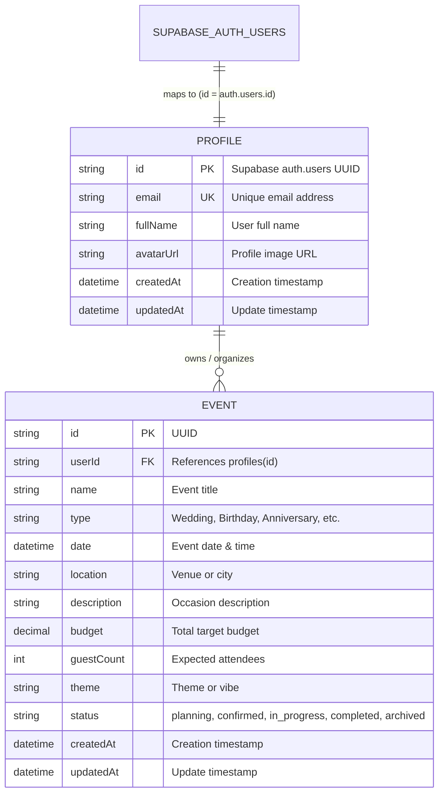

# EventPilot AI — Database Design (Phase 1)

## Overview

EventPilot AI exclusively uses **Supabase PostgreSQL** as its relational database, accessed via **Prisma ORM**.
No local PostgreSQL instance, container, or secondary database is used.

Authentication is managed exclusively by **Supabase Auth** (`auth.users`). Application user records reside in the `profiles` table, linked by UUID primary key.

---

## Entity-Relationship Diagram

---

## Database Schema

### 1. `profiles` Table
Stores extended user profile information for authenticated accounts.

| Column | Type | Constraints | Description |
|---|---|---|---|
| `id` | `VARCHAR(36)` | `PRIMARY KEY` | Matches Supabase Auth `auth.users.id` UUID. |
| `email` | `VARCHAR(255)` | `UNIQUE, NOT NULL` | Synchronized user email. |
| `fullName` | `VARCHAR(255)` | `NULLABLE` | Full name of the user. |
| `avatarUrl` | `TEXT` | `NULLABLE` | Avatar image URL. |
| `createdAt` | `TIMESTAMPTZ` | `NOT NULL, DEFAULT now()` | Timestamp of profile creation. |
| `updatedAt` | `TIMESTAMPTZ` | `NOT NULL` | Timestamp of last profile update. |

### 2. `events` Table
Stores events and celebrations created by users.

| Column | Type | Constraints | Description |
|---|---|---|---|
| `id` | `VARCHAR(36)` | `PRIMARY KEY, DEFAULT uuid()` | Unique event identifier. |
| `userId` | `VARCHAR(36)` | `FOREIGN KEY (profiles.id) ON DELETE CASCADE` | Creator/owner identifier. |
| `name` | `VARCHAR(255)` | `NOT NULL` | Name or celebration title. |
| `type` | `VARCHAR(100)` | `NOT NULL, DEFAULT 'Wedding'` | Event category aligned with frontend types. |
| `date` | `TIMESTAMPTZ` | `NOT NULL` | Scheduled date of celebration. |
| `location` | `VARCHAR(255)` | `NOT NULL` | Venue or city. |
| `description` | `TEXT` | `NULLABLE` | Occasion description. |
| `budget` | `DECIMAL(12, 2)` | `NOT NULL, DEFAULT 0.00` | Target financial budget. |
| `guestCount` | `INTEGER` | `NOT NULL, DEFAULT 0` | Target guest count. |
| `theme` | `VARCHAR(255)` | `NULLABLE` | Event theme or aesthetic. |
| `status` | `VARCHAR(50)` | `NOT NULL, DEFAULT 'planning'` | Planning lifecycle state. |
| `createdAt` | `TIMESTAMPTZ` | `NOT NULL, DEFAULT now()` | Creation timestamp. |
| `updatedAt` | `TIMESTAMPTZ` | `NOT NULL` | Auto-updating timestamp. |

### Database Indexes
- `idx_events_userId` ON `events(userId)` — Speeds up queries fetching all events for a given user.
- `idx_events_status` ON `events(status)` — Optimizes status filtering on user dashboards.
- `idx_events_date` ON `events(date)` — Optimizes chronological timeline queries.

---

## Supabase Auth Integration

1. **Authentication Authority**: Supabase Auth handles password management, OAuth providers, MFA, session refresh tokens, and JWT issuance.
2. **Profile Mapping**: Each `profiles` record has `id` set to the UUID provided by Supabase Auth (`auth.users.id`). No separate independent password authentication is maintained.
3. **Least Privilege**: The backend server accesses the database using connection credentials protected server-side. The Supabase service role key is never sent to the browser.
4. **Connection Pooling**: Runtime queries connect to Supabase port `6543` using PgBouncer pooler (`DATABASE_URL`), while direct migrations connect to port `5432` (`DIRECT_URL`).
