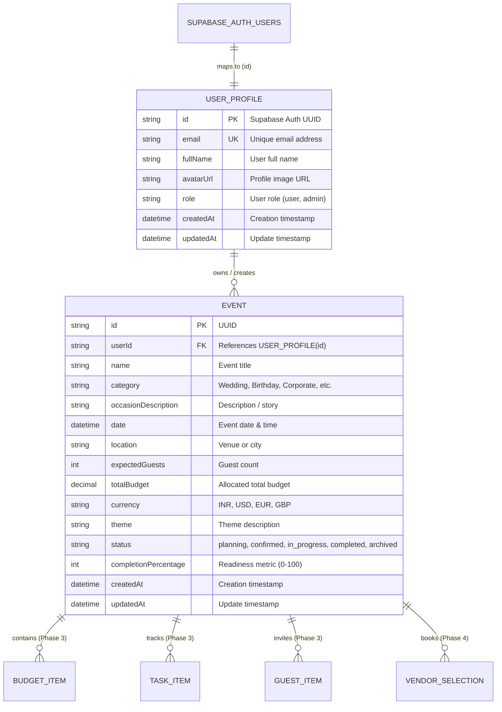

# EventPilot AI — Database Design (Phase 1)

## Overview

EventPilot AI uses **Supabase PostgreSQL** as its managed database, accessed through **Prisma ORM**.

Authentication is delegated to **Supabase Auth** (`auth.users`), while application domain profiles and event data reside in public schema tables linked via foreign key constraints.

---

## Entity-Relationship Diagram

---

## Schema Details

### 1. `user_profiles` Table
Stores extended user profile information for authenticated accounts.

| Column | Type | Constraints | Description |
|---|---|---|---|
| `id` | `VARCHAR(36)` | `PRIMARY KEY` | Corresponds directly to `auth.users.id` in Supabase Auth. |
| `email` | `VARCHAR(255)` | `UNIQUE, NOT NULL` | Synchronized email address. |
| `fullName` | `VARCHAR(255)` | `NULLABLE` | Display name of the user. |
| `avatarUrl` | `TEXT` | `NULLABLE` | URL pointing to user profile avatar. |
| `role` | `VARCHAR(50)` | `NOT NULL, DEFAULT 'user'` | Access control role. |
| `createdAt` | `TIMESTAMPTZ` | `NOT NULL, DEFAULT now()` | Timestamp of record creation. |
| `updatedAt` | `TIMESTAMPTZ` | `NOT NULL` | Automatically updated timestamp. |

### 2. `events` Table
Stores events and celebrations created and managed by users.

| Column | Type | Constraints | Description |
|---|---|---|---|
| `id` | `VARCHAR(36)` | `PRIMARY KEY, DEFAULT uuid()` | Unique identifier for event. |
| `userId` | `VARCHAR(36)` | `FOREIGN KEY (user_profiles.id) ON DELETE CASCADE` | Event creator/owner identifier. |
| `name` | `VARCHAR(255)` | `NOT NULL` | Name or celebration title. |
| `category` | `VARCHAR(100)` | `NOT NULL, DEFAULT 'Wedding'` | Event category aligned with frontend types. |
| `occasionDescription` | `TEXT` | `NULLABLE` | Detailed event brief. |
| `date` | `TIMESTAMPTZ` | `NOT NULL` | Scheduled date of celebration. |
| `location` | `VARCHAR(255)` | `NOT NULL` | Venue or city. |
| `expectedGuests` | `INTEGER` | `NOT NULL, DEFAULT 0` | Target guest count. |
| `totalBudget` | `DECIMAL(12, 2)` | `NOT NULL, DEFAULT 0.00` | Target financial budget. |
| `currency` | `VARCHAR(10)` | `NOT NULL, DEFAULT 'INR'` | Currency code (INR, USD, EUR, etc.). |
| `theme` | `VARCHAR(255)` | `NULLABLE` | Event theme or aesthetic. |
| `status` | `VARCHAR(50)` | `NOT NULL, DEFAULT 'planning'` | Planning lifecycle state. |
| `completionPercentage` | `INTEGER` | `NOT NULL, DEFAULT 0` | Computed planning progress. |
| `createdAt` | `TIMESTAMPTZ` | `NOT NULL, DEFAULT now()` | Creation timestamp. |
| `updatedAt` | `TIMESTAMPTZ` | `NOT NULL` | Auto-updating modification timestamp. |

### Database Indexes
- `idx_events_userId` ON `events(userId)` — Accelerates querying all events belonging to a user.
- `idx_events_status` ON `events(status)` — Optimizes dashboard status filtering.
- `idx_events_date` ON `events(date)` — Optimizes chronological timeline and upcoming event queries.

---

## Supabase Auth Integration

1. **Authentication Authority**: Supabase Auth manages password hashing, session tokens, social OAuth logins, and refresh tokens.
2. **Profile Synchronization**: When a user registers through Supabase Auth, a trigger or Phase 2 auth hook creates the corresponding record in `user_profiles` with `id = auth.users.id`.
3. **Row Level Security (RLS)**: In Phase 2, Supabase RLS policies will enforce that `auth.uid() = userId`, ensuring full data privacy.
4. **Prisma Connection Pooling**: Runtime uses Supabase connection pooler on port `6543` with `?pgbouncer=true`, and CLI migrations use direct port `5432`.
