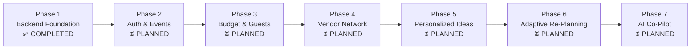

# EventPilot AI — Backend Implementation Roadmap

This document outlines the multi-phase implementation roadmap for the EventPilot AI backend architecture. It clearly delineates completed foundation components from upcoming feature releases.

---

## Roadmap Overview

---

## Phase Details

### ✅ Phase 1: Backend Foundation Setup, Documentation & Testing
**Status**: **COMPLETED**
- [x] Decoupled Express.js & TypeScript architecture (`app.ts` & `server.ts`).
- [x] Fail-fast environment variable validation with Zod and sensitive field masking.
- [x] Helmet security headers, CORS origin protection, JSON body parsers.
- [x] Pino and pino-http structured JSON logging with header redaction.
- [x] Standardized API response (`ApiResponse`) and error handling (`ApiError`, `errorHandler`).
- [x] Complete health check API (`GET /api/health`, `/api/health/db`, `/api/health/detailed`).
- [x] Supabase PostgreSQL connectivity setup with Prisma ORM (`UserProfile` & `Event` models).
- [x] Python 3.11+ FastAPI AI service foundation (`GET /health`) with Pydantic v2 settings.
- [x] Automated test suites in Vitest (Node.js) and Pytest (Python).
- [x] Dockerfile & Docker Compose multi-service configurations.
- [x] Comprehensive documentation set and GitHub version control integration.

---

### ⏳ Phase 2: Authentication & Event Management
**Status**: **PLANNED (Next Phase)**
- [ ] Supabase Auth JWT verification middleware on Express routes (`auth.middleware.ts`).
- [ ] User profile synchronization hook (`user_profiles`).
- [ ] Event CRUD APIs (`POST /api/events`, `GET /api/events`, `GET /api/events/:id`, `PATCH /api/events/:id`, `DELETE /api/events/:id`).
- [ ] Event ownership authorization policies and Supabase Row Level Security (RLS).
- [ ] Event duplication and archival workflows.

---

### ⏳ Phase 3: Budget, Guests & Timeline
**Status**: **PLANNED**
- [ ] Budget category schema (`BudgetCategoryItem`) and financial analytics endpoints.
- [ ] Guest list management (`GuestItem`) with RSVP tracking and dietary categorization.
- [ ] Timeline milestone and task tracking (`TaskItem`) with dependency relationships.
- [ ] Event readiness calculation algorithm.

---

### ⏳ Phase 4: Community Vendor Recommendation System
**Status**: **PLANNED**
- [ ] Community vendor directory schema (`CommunityVendor`) with moderation status flags.
- [ ] Private event vendor shortlist (`UserEventVendor`) with quotation tracking.
- [ ] City, category, and budget-range filtering and search APIs.
- [ ] Vendor quotation comparison service.

---

### ⏳ Phase 5: Personalized Ideas AI
**Status**: **PLANNED**
- [ ] Internal backend proxy to Python AI service (`/ai-service/api/v1/ideas`).
- [ ] Google Gemini 2.5 API integration for personalized theme, decor, food, and music concepts.
- [ ] Cultural and dietary context prompt engineering.
- [ ] Idea bookmarking and event integration.

---

### ⏳ Phase 6: Adaptive Re-Planning Engine
**Status**: **PLANNED**
- [ ] Dynamic event parameter shift detection (guest count delta, budget cut/increase, date changes).
- [ ] Multi-variable budget re-allocation algorithm with constraint preservation.
- [ ] Timeline shift recalculation and urgent task flagging.
- [ ] Plan versioning and audit history (`PlanVersion`).

---

### ⏳ Phase 7: AI Co-Pilot
**Status**: **PLANNED**
- [ ] Real-time conversational assistant powered by Gemini Live / Chat.
- [ ] Contextual suggestion actions (`rebalance_budget`, `compare_vendors`, `add_task`).
- [ ] Streaming response support via Server-Sent Events (SSE) or WebSockets.
