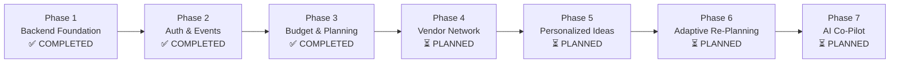

# EventPilot AI — Backend Implementation Roadmap

This document outlines the multi-phase implementation roadmap for the EventPilot AI backend architecture. It clearly delineates completed foundation components from upcoming feature releases.

---

## Roadmap Overview

---

## Phase Details

### ✅ Phase 1: Backend Foundation Setup, Documentation & Testing
**Status**: **COMPLETED**
- [x] Decoupled Express.js & TypeScript architecture (`app.ts` & `server.ts`).
- [x] Fail-fast environment variable validation with Zod and sensitive field masking.
- [x] Helmet security headers, CORS origin protection, JSON body parsers.
- [x] Pino and pino-http structured JSON logging with header redaction.
- [x] Standardized API response (`ApiResponse`) and error handling (`ApiError`, `errorHandler`).
- [x] Complete health check API (`GET /api/health`, `/api/health/db`, `/api/health/detailed`).
- [x] Supabase PostgreSQL connectivity setup with Prisma ORM (`Profile` & `Event` models).
- [x] Python 3.11+ FastAPI AI service foundation (`GET /health`) with Pydantic v2 settings.
- [x] Automated test suites in Vitest (Node.js) and Pytest (Python).
- [x] Comprehensive technical documentation across root and backend directories.

---

### ✅ Phase 2: Authentication, User Profiles & Event Management
**Status**: **COMPLETED**
- [x] Supabase Auth client & server-side JWT verification middleware (`auth.middleware.ts`).
- [x] Reusable authentication middleware rejecting missing, invalid, or expired tokens (401).
- [x] Automatic, idempotent user profile provisioning & updates (`/api/users/me`).
- [x] Complete Event CRUD endpoints (`POST`, `GET`, `GET :id`, `PATCH :id`, `DELETE :id`).
- [x] Strict user ownership and tenant data isolation (cross-user access returns 404).
- [x] Comprehensive query filtering (type, status), sorting (date, created, budget), and pagination.
- [x] Frontend React integration with Supabase Auth, protected routes, Bearer token API client.
- [x] Automated Vitest & Supertest unit/integration test suites with 100% pass rate.
- [x] Complete Phase 2 architecture, database, API, authentication, testing, and completion documentation.

---

### ✅ Phase 3: Event Planning Management (Budget, Expenses, Guests, Tasks & Timeline)
**Status**: **COMPLETED**
- [x] Prisma database models: `BudgetCategory`, `Expense`, `Guest`, `Task`, `TaskDependency`, `TimelineItem`.
- [x] Idempotent PostgreSQL migration SQL script with non-destructive constraint application.
- [x] Budget Planner module: Categories CRUD, expense vouchers CRUD, category unassignment on deletion.
- [x] Deterministic financial summary & variance calculation (Total Budget, Allocated, Estimated, Actual, Remaining, Utilization, Warning alerts).
- [x] Guest Management module: Attendees CRUD, search, category filtering, RSVP tracking, headcount aggregation with plus-ones.
- [x] Task Management module: Tasks CRUD, priority and status filtering, due date sorting, assignee labels.
- [x] Task Dependency engine: Strict cycle detection using BFS traversal, self-dependency prevention, prerequisite completion guards.
- [x] Event Timeline Run-of-Show module: Chronological schedule CRUD, start/end time chronological validation, location & category classification.
- [x] Cross-tenant event data isolation: Complete ownership verification returning 404 for foreign/inaccessible event resources.
- [x] Frontend React integration: Connected Zustand store, apiClient methods, BudgetPage, GuestPage, and TimelinePage.
- [x] Automated integration testing: 4 new suites (40 new tests), total 11 suites, 79/79 passing tests with 100% success rate.

---

### ⏳ Phase 4: Community Vendor Recommendation System
**Status**: **PLANNED**
- [ ] Community vendor directory schema (`CommunityVendor`) with moderation status flags.
- [ ] Private event vendor shortlist (`UserEventVendor`) with quotation tracking.
- [ ] City, category, and budget-range filtering and search APIs.
- [ ] Vendor quotation comparison service.

---

### ⏳ Phase 5: Personalized Ideas AI
**Status**: **PLANNED**
- [ ] Internal backend proxy to Python AI service (`/ai-service/api/v1/ideas`).
- [ ] Google Gemini 2.5 API integration for personalized theme, decor, food, and music concepts.
- [ ] Cultural and dietary context prompt engineering.
- [ ] Idea bookmarking and event integration.

---

### ⏳ Phase 6: Adaptive Re-Planning Engine
**Status**: **PLANNED**
- [ ] Dynamic event parameter shift detection (guest count delta, budget cut/increase, date changes).
- [ ] Multi-variable budget re-allocation algorithm with constraint preservation.
- [ ] Timeline shift recalculation and urgent task flagging.
- [ ] Plan versioning and audit history (`PlanVersion`).

---

### ⏳ Phase 7: AI Co-Pilot
**Status**: **PLANNED**
- [ ] Real-time conversational assistant powered by Gemini Live / Chat.
- [ ] Contextual suggestion actions (`rebalance_budget`, `compare_vendors`, `add_task`).
- [ ] Streaming response support via Server-Sent Events (SSE) or WebSockets.
