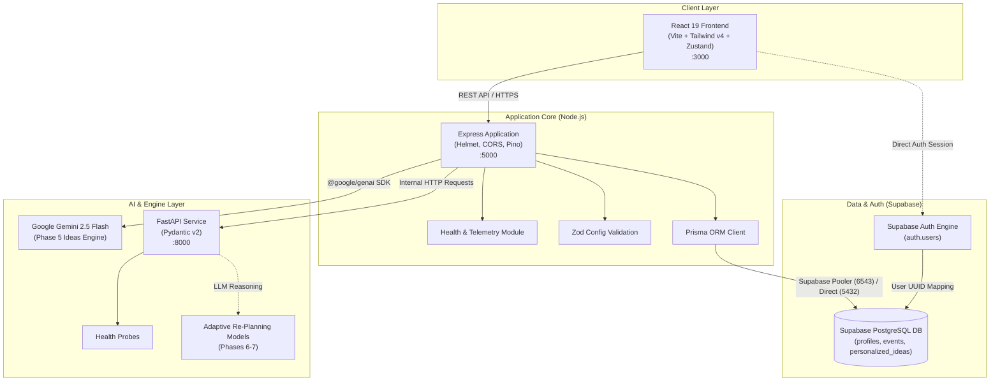

# EventPilot AI — System Architecture

## 1. System Overview

EventPilot AI is an intelligent celebration and event planning platform. The repository is organized into three distinct tiers:
1. **Frontend**: Vite + React 19 + TypeScript web application with Zustand and Tailwind CSS v4.
2. **Main Backend**: Node.js + Express.js + TypeScript service managing business workflows, Supabase PostgreSQL data persistence, security middlewares, and response formatting.
3. **AI Microservice**: Python 3.11+ FastAPI service providing specialized computation, health monitoring, and future Gemini AI reasoning integration.

> [!IMPORTANT]
> Supabase PostgreSQL is used exclusively. No local PostgreSQL database or containers are utilized.

---

## 2. Architecture Diagram

---

## 3. Component Responsibilities

### React Frontend (`/src`)
- Responsive user interface for event dashboards, wizards, guest management, budgets, and vendor curation.
- Manages client state via Zustand (`useAppStore.ts`).
- Interacts with the Express backend using standardized JSON response shapes.

### Node.js + Express Backend (`/backend`)
- **API Routing**: Exposes modular REST endpoints (`/api/...`).
- **Security**: Enforces CORS, Helmet protection, Zod environment validation, and JWT verification.
- **Data Access**: Interfaces directly with Supabase PostgreSQL using Prisma ORM.
- **Service Orchestration**: Internal proxy between web clients and the Python AI microservice.

### Python FastAPI AI Service (`/ai-service`)
- **Internal Microservice**: Executes computationally intensive planning logic and prompt pipelines.
- **Model Isolation**: Keeps Python-based machine learning dependencies isolated from the Node.js web server.
- **Future AI Capabilities**: Hosts the Adaptive Re-Planning Engine and Gemini 2.5 Flash agents in Phases 5–7.

### Supabase & PostgreSQL
- **Authentication**: Issues JWTs and manages user identities securely in `auth.users`.
- **Relational Persistence**: Stores structured profiles and events directly in Supabase PostgreSQL.
- **Connection Management**: Supabase connection pooler (pgbouncer) handles concurrent traffic on port 6543.
