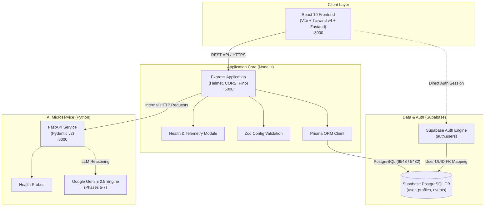
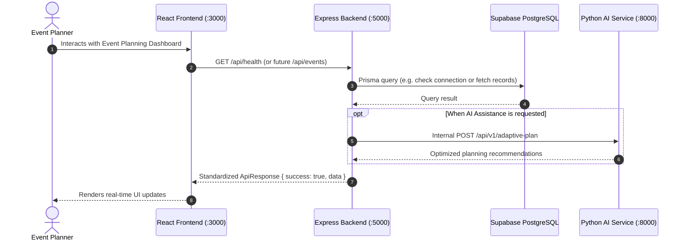

# EventPilot AI — System Architecture

## 1. System Overview

EventPilot AI is an AI-powered celebration and event-planning platform. The system is architected as a cohesive monorepo composed of three primary layers:
1. **Frontend**: Vite + React 19 + TypeScript web application.
2. **Main Backend**: Node.js + Express.js + TypeScript service managing business logic, Supabase PostgreSQL data persistence, authentication integration, and security boundaries.
3. **AI Microservice**: Python 3.11+ FastAPI service providing specialized computation, machine learning pipelines, and upcoming Gemini LLM reasoning capabilities.

---

## 2. Architecture Diagram

---

## 3. Component Responsibilities

### React Frontend (`/src`)
- Responsive user interface for event dashboards, wizards, guest management, budgets, and vendor curation.
- Manages client state via Zustand (`useAppStore.ts`).
- Communicates with the Express backend using standard REST JSON payloads.

### Node.js + Express Backend (`/backend`)
- **API Gateway & Routing**: Exposes unified, versioned REST endpoints (`/api/...`).
- **Security & Authorization**: Enforces CORS, Helmet protection, payload validation with Zod, and JWT token verification.
- **Data Access & Modeling**: Interfaces with Supabase PostgreSQL using Prisma ORM.
- **Service Orchestration**: Mediates communication between client requests and the internal Python AI microservice.

### Python FastAPI AI Service (`/ai-service`)
- **Internal Specialization**: Executes computationally intensive planning logic and prompt pipelines.
- **Model Isolation**: Keeps Python-based machine learning dependencies isolated from the Node.js web server.
- **Future AI Capabilities**: Hosts the Adaptive Re-Planning Engine and Gemini 2.5 Flash agents in Phases 5–7.

### Supabase & PostgreSQL
- **Authentication**: Issues JWTs and manages user identities securely in `auth.users`.
- **Relational Persistence**: Stores structured user profiles, events, budgets, tasks, and vendor contracts.
- **Connection Management**: Supabase connection pooler (pgbouncer) handles concurrent traffic efficiently.

---

## 4. End-to-End Data Flow

