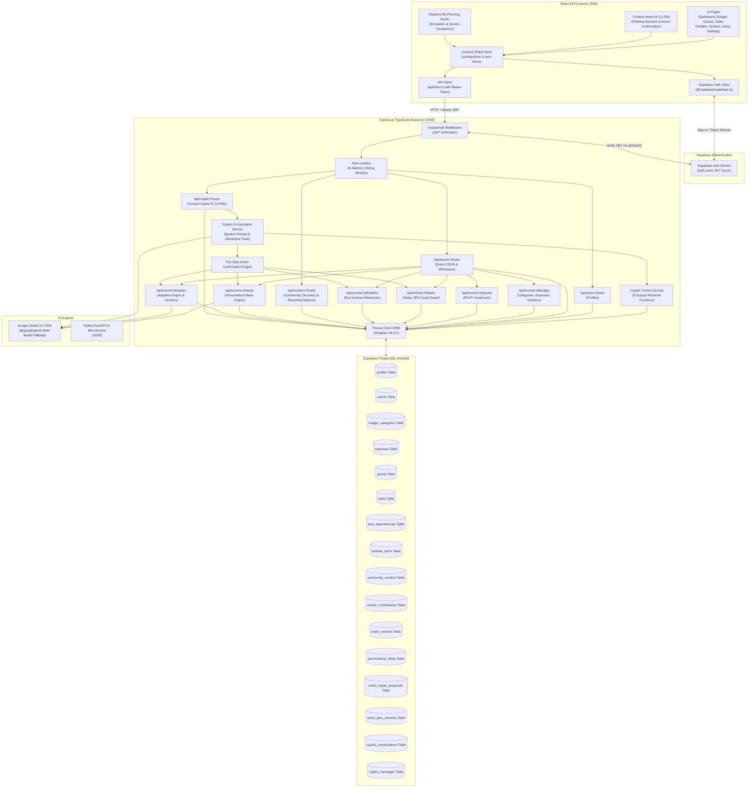

# EventPilot AI System Architecture — Complete Multi-Phase Specification

**Platform Version**: EventPilot AI 1.0 (Phases 1–7 Final Architecture)  
**Last Updated**: November 1, 2026  
**Status**: Production Ready & Fully Verified

---

## 1. System Overview

EventPilot AI employs a decoupled multi-tier architecture connecting a modern React 19 frontend client to an Express.js TypeScript backend, a Supabase-hosted PostgreSQL database, and Google Gemini AI engines.

---

## 2. Multi-Phase Capabilities & Business Engines

### Phase 1: Foundation & Security Scaffolding
- PostgreSQL database hosted exclusively on Supabase.
- Strict Prisma ORM singleton client pattern.
- Pino structured logging and environment variable masking.
- Centralized error and 404 middleware.

### Phase 2: Authentication & Event CRUD
- Supabase Auth issuing JWT Bearer tokens with client-side auto-refresh.
- Multi-tenant data isolation: all event queries enforce `event.userId === req.user.id`.
- User profiles synced directly to `auth.users.id`.

### Phase 3: Core Event Planning Modules
- **Budget Planner**: Dynamic category allocations, expense vouchers, variance tracking, and automated deficit alerts.
- **Guest Management**: RSVP state tracking (`pending`, `attending`, `declined`), plus-one headcount aggregation, and dietary preferences.
- **Task Management**: Milestone checklists, due date prioritization, and Breadth-First Search (BFS) dependency cycle detection.
- **Timeline**: Chronological run-of-show milestones with start/end time validation.

### Phase 4: Community Vendor Recommendation Network
- Public directory of verified, price-benchmarked community vendors.
- Transparent recommendation engine scoring vendors from 0 to 100 based on event category, city match, and budget suitability.
- Event workspace vendor assignments with cost tracking.

### Phase 5: Personalized Ideas Engine (Gemini 2.5)
- AI-synthesized celebration concepts strictly tailored to verified event type, budget, guest count, and theme.
- Category filtering and bookmarking to favorites.

### Phase 6: Adaptive Event Re-Planning Engine
- Real-time simulation and rebalancing when financial allocations, guest headcounts, or celebration dates shift.
- Deterministic impact calculation engine independent of LLMs.
- Concurrency-safe proposal lifecycle with stale-state conflict detection (`baseEventUpdatedAt`).
- Atomic Prisma transactions preserving actual expenses while updating approved dimensions.
- Immutable event plan snapshots and sequential version history (`v1.0`, `v2.0`...).

### Phase 7: Context-Aware AI Co-Pilot (Final Phase)
- **Natural-Language Event Assistance**: Answers queries using actual verified database records across all planning modules.
- **8 Backend-Scoped Context Retrieval Tools**: Scoped strictly to the authenticated user and authorized event.
- **Strict Read-Only Default**: AI cannot directly mutate database records from chat text.
- **Two-Step Confirmed Actions Engine**: Previews actions (create task, schedule milestone, save idea, draft proposal) and requires explicit user confirmation.
- **Persistent Conversation Sessions**: Stores conversation history in `copilot_conversations` and `copilot_messages` with strict user isolation.
- **Resilient Fallback**: Gracefully falls back to deterministic fact summaries if Gemini API encounters rate limits or network timeouts.

---

## 3. Security, Authorization & Tenant Isolation

1. **Authentication Enforcement**: All API endpoints require a valid Supabase Auth Bearer JWT token validated via `requireAuth`.
2. **Server-Side Ownership Verification**: Every event and conversation query verifies ownership (`userId === req.user.id`) on the server.
3. **No Direct Database Access for AI**: Gemini never receives direct SQL or Prisma access; it interacts exclusively through allowlisted context functions.
4. **Prompt Injection Neutralization**: All user inputs and database records are treated as untrusted data within strict system prompt boundaries.
5. **No Secret Leakage**: API keys, database credentials, and internal prompt templates are masked and never exposed.
