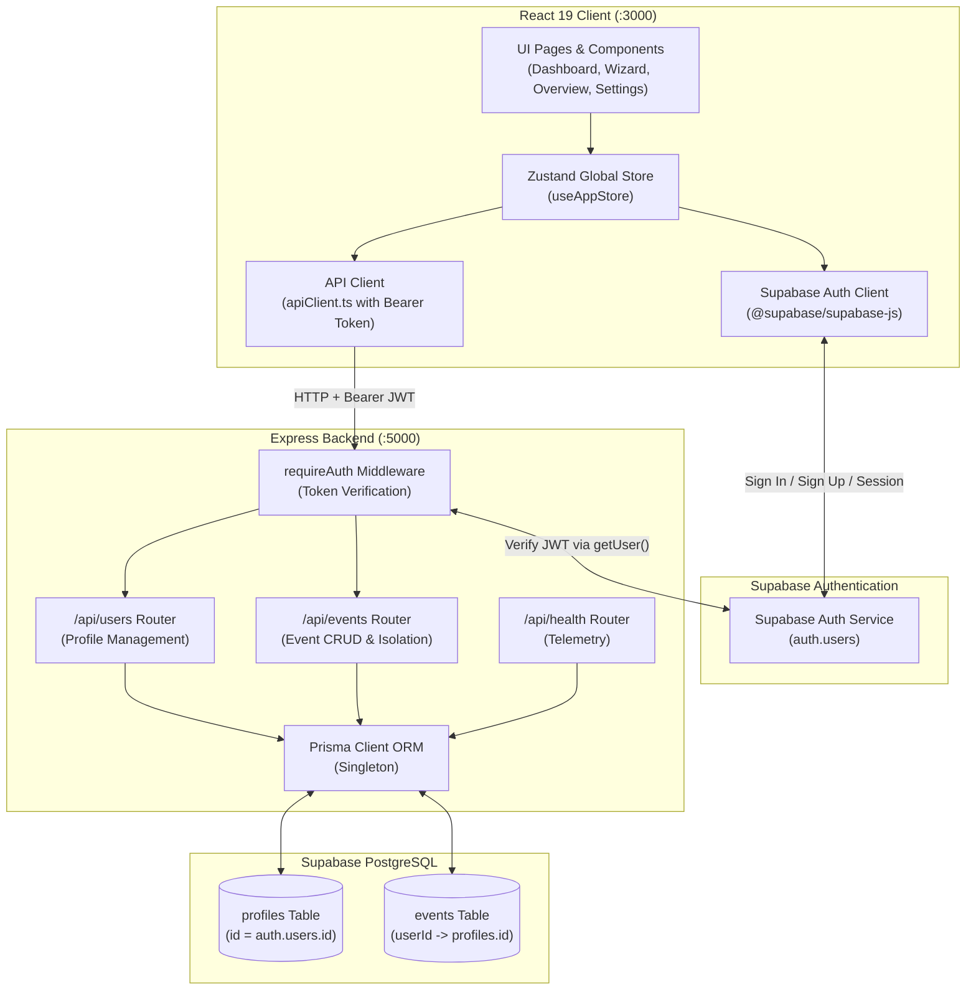

# EventPilot AI Architecture — Phase 2

## 1. System Overview

EventPilot AI employs a decoupled three-tier architecture connecting a React 19 frontend client to an Express.js TypeScript backend and a Supabase-hosted PostgreSQL database.

---

## 2. Communication & Authentication Flow

1. **User Authentication**:
   - The user provides credentials on the frontend Login/Signup form.
   - The frontend `@supabase/supabase-js` client submits credentials to Supabase Auth.
   - Supabase authenticates the user and issues a signed JWT access token.
   - The frontend stores the session securely and tracks the current authenticated state.

2. **API Request Dispatch**:
   - When communicating with the Express backend, `apiClient` attaches the JWT in the `Authorization` header:
     `Authorization: Bearer <access_token>`

3. **Backend Middleware Verification**:
   - `requireAuth` middleware intercepts the request.
   - Checks presence and Bearer format of the header (rejects with 401 if missing/malformed).
   - Validates the token against Supabase Auth (`supabase.auth.getUser(token)`).
   - If invalid or expired, returns HTTP 401 Unauthorized.
   - If valid, extracts the verified user ID and metadata (`id`, `email`, `fullName`, `avatarUrl`) and attaches it to `req.user`.

4. **Resource Ownership & Data Isolation**:
   - Domain controllers (`UserController`, `EventController`) extract `req.user.id`.
   - Never trust user IDs provided in the request body or query parameters.
   - Queries to `events` table strictly constrain `where: { userId: req.user.id }`.
   - If a user attempts to access, update, or delete another user's event, the server returns HTTP 404 Not Found to prevent leaking the existence of unauthorized resources.

---

## 3. Database Layer & Prisma ORM

- **Single Database Authority**: Hosted Supabase PostgreSQL exclusively.
- **Connection Strategy**:
  - Connection pooling (Port 6543) with PgBouncer for API runtime queries.
  - Direct connection (Port 5432) for Prisma CLI schema migrations.
- **Foreign Key Relationships**:
  - `Profile` primary key `id` corresponds directly to `auth.users.id` (UUID).
  - `Event` belongs to one `Profile` via `userId` foreign key.
  - Deleting an event never affects shared community vendor records or other users' data.

