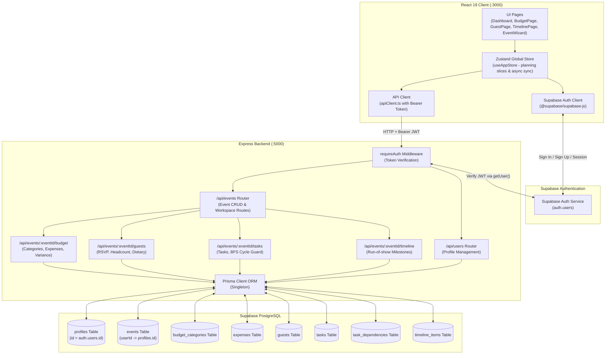

# EventPilot AI Architecture — Phase 3

## 1. System Overview

EventPilot AI employs a decoupled three-tier architecture connecting a React 19 frontend client to an Express.js TypeScript backend and a Supabase-hosted PostgreSQL database. Phase 3 introduces complete Event Planning Management modules (Budget, Expenses, Guests, Tasks, Dependencies, and Day-Of Timeline).

---

## 2. Phase 3 Planning Modules & Business Logic

### 2.1 Budget Planner & Expense Tracking
- **Deterministic Budget Metrics**:
  $$\text{Total Budget} = \text{Event Target Budget}$$
  $$\text{Total Allocated} = \sum \text{BudgetCategory.allocatedAmount}$$
  $$\text{Total Estimated} = \sum \text{Expense.estimatedAmount}$$
  $$\text{Total Actual} = \sum \text{Expense.actualAmount}$$
  $$\text{Remaining Budget} = \text{Total Budget} - \text{Total Actual}$$
  $$\text{Budget Utilization} = \begin{cases} 0\% & \text{if Total Budget} = 0 \\ \left(\frac{\text{Total Actual}}{\text{Total Budget}}\right) \times 100 & \text{otherwise} \end{cases}$$
- **Variance Analysis**:
  For each category: $\text{Variance} = \text{allocatedAmount} - \sum \text{actualAmount}$. If actual > allocated, `isOverBudget` is flagged.
- **Automated Warning Banner**:
  - `CRITICAL`: When actual spending exceeds the total event budget.
  - `WARNING`: When actual spending exceeds 90% of the total budget.
  - `ALLOCATION_EXCEEDED`: When total allocated across categories exceeds total budget.
- **Safe Category Deletion**:
  Deleting a category sets `categoryId = null` for all linked expenses, preserving historical payment vouchers and accounting data.

### 2.2 Guest Management & Headcount Aggregation
- **RSVP States**: `pending`, `invited`, `attending`, `declined`.
- **Headcount Calculation**:
  - Direct attending count: $\sum [\text{rsvpStatus} = \text{'attending'}]$.
  - Plus-one attending count: $\sum [\text{plusOneCount} \mid \text{rsvpStatus} = \text{'attending'}]$.
  - Confirmed total headcount: Direct attending + Plus-ones attending.
- **Categorization**: Family, Friends, Colleagues, VIP, Other.
- **Dietary & Notes**: Captured per guest to facilitate caterer handoff.

### 2.3 Task Management & Dependency Engine
- **Task Distinction**: Tasks represent planning activities (work to complete beforehand) distinguished from timeline run-of-show activities.
- **Priority & Status**: Priority (`low`, `medium`, `high`, `urgent`), Status (`todo`, `in_progress`, `completed`, `cancelled`).
- **Dependency Cycle Guard**:
  When a dependency $A \rightarrow B$ is added:
  1. Verify both tasks belong to the same event.
  2. Guard against self-dependency ($A = B$).
  3. Run Breadth-First Search (BFS) starting from candidate prerequisite $B$ traversing downstream dependencies. If $A$ is reachable from $B$, adding $A \rightarrow B$ creates a cycle; reject with HTTP `409 Conflict`.
- **Prerequisite Completion Guard**:
  When updating a task's status to `completed`, verify all direct prerequisite tasks are already in `completed` status. If incomplete prerequisites exist, update is blocked with HTTP `400 Bad Request` unless explicitly overridden via `overrideIncompletePrerequisites: true`.

### 2.4 Event Timeline (Run-of-Show)
- Represents scheduled day-of event milestones and activities (e.g. "Ceremony Prelude", "Dinner & Toast", "Cake Cutting").
- Start and end time validation: `endTime` must be equal to or later than `startTime`.
- Chronological sorting: API returns items ordered by `startTime ASC`.

---

## 3. Security, Authorization & Tenant Isolation

1. **Authentication Guard**:
   All endpoints require a valid Supabase Auth Bearer JWT token validated via `requireAuth` middleware.
2. **Event Ownership Guard**:
   Every event workspace endpoint verifies ownership:
   `const event = await prisma.event.findFirst({ where: { id: eventId, userId: req.user.id } });`
   If the event does not exist or belongs to another user, HTTP `404 Not Found` is returned immediately without leaking resource existence.
3. **Sub-Resource Ownership**:
   All sub-resource queries (`categories`, `expenses`, `guests`, `tasks`, `timeline`) enforce both `id` and `eventId`.
4. **No Shared Table Leaks**:
   Deleting an event cascades deletion to its private sub-items without affecting any other user or system tables.
