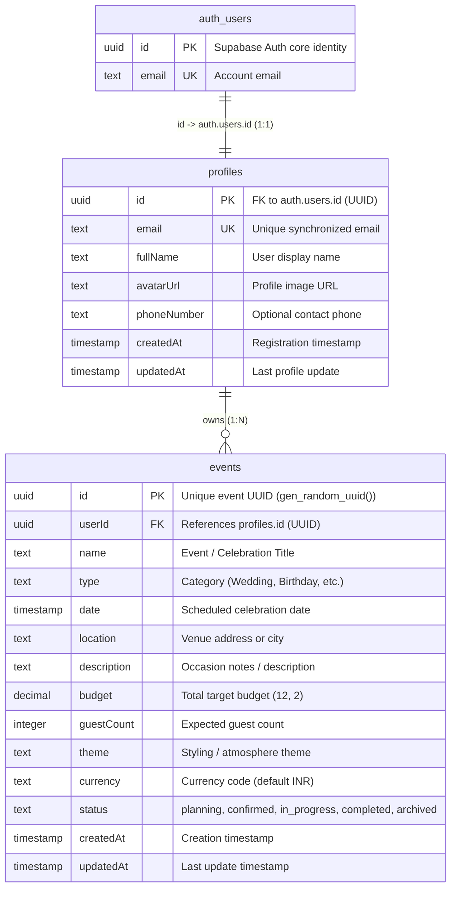

# EventPilot AI Database Design — Phase 2

## 1. Database Architecture

- **Host**: Supabase PostgreSQL exclusively (no local database servers permitted).
- **ORM**: Prisma ORM v6.
- **Connection Model**:
  - Connection pooling via PgBouncer on port `6543` for application queries.
  - Direct connection on port `5432` for administrative Prisma schema migrations.

---

## 2. Entity-Relationship Model

---

## 3. Indexes & Constraints

### `profiles` Table
- `PRIMARY KEY ("id")` (`UUID`)
- `UNIQUE INDEX ("email")` — Enforces email consistency with Supabase Auth.
- `FOREIGN KEY ("id") REFERENCES "auth"."users"("id") ON DELETE CASCADE ON UPDATE CASCADE` — Links user profile lifecycle directly to Supabase Auth.

### `events` Table
- `PRIMARY KEY ("id")` (`UUID`, default `gen_random_uuid()`)
- `INDEX ("userId")` — Optimizes fast lookup of user-owned events and tenant isolation.
- `INDEX ("date")` — Optimizes countdown calculations, upcoming event queries, and date range filters.
- `INDEX ("status")` — Optimizes dashboard status filtering (`planning`, `completed`, `in_progress`).
- `FOREIGN KEY ("userId") REFERENCES "public"."profiles"("id") ON DELETE CASCADE ON UPDATE CASCADE`

---

## 4. Tenant Data Isolation & Ownership Rules

1. **Strict Ownership Enforced at Database Access Level**:
   - Every event query (`findMany`, `findUnique`, `update`, `delete`) must verify that `userId === req.user.id`.
2. **Safe Event Deletion**:
   - Deleting an event deletes only that user's private event record and associated private sub-items.
   - Deleting an event **never** triggers deletion of community shared vendor directories or other users' data.
3. **Idempotent Profile Provisioning**:
   - When a Supabase Auth user queries `/api/users/me` or creates an event, the system automatically checks for the existence of the `profiles` record and creates it if not already present.

---

## 5. Migration Safety Review

The migration SQL has been prepared safely and idempotently in:
`backend/prisma/migrations/20261031_phase2_auth_events/migration.sql`

### Safety Audit:
- **No Destructive Operations**: Zero `DROP TABLE`, `DROP COLUMN`, `TRUNCATE`, or destructive data conversions.
- **Idempotency**: All tables are created with `IF NOT EXISTS`. Indexes use `IF NOT EXISTS`.
- **Foreign Key Guards**: Constraints `profiles_id_fkey` and `events_userId_fkey` are wrapped in `DO $$ BEGIN ... END $$` blocks checking `information_schema` and `pg_constraint` before applying.
- **Production Safety**: The migration is prepared for administrative review and will not execute automatically against a production Supabase database without explicit confirmation.

