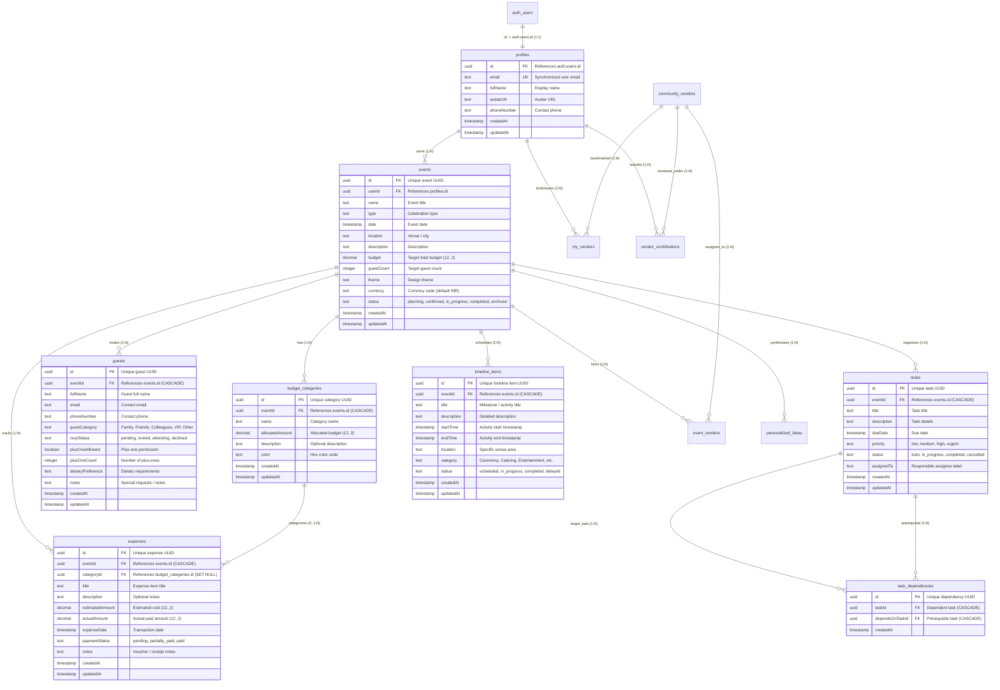

# EventPilot AI Database Design — Phase 3

## 1. Database Architecture

- **Host**: Supabase PostgreSQL exclusively (no local database servers permitted).
- **ORM**: Prisma ORM v6.
- **Connection Model**:
  - Connection pooling via PgBouncer on port `6543` for application queries.
  - Direct connection on port `5432` for administrative Prisma schema migrations.

---

## 2. Entity-Relationship Model

---

## 3. Tables & Schema Specifications

### 3.1 `budget_categories` Table
- `id`: UUID (Primary Key, default `gen_random_uuid()`)
- `eventId`: UUID (Foreign Key references `events.id` ON DELETE CASCADE)
- `name`: String (Category name, e.g., "Venue & Catering")
- `allocatedAmount`: Decimal(12, 2) (Allocated budget for this category, >= 0)
- `description`: String (Optional category description)
- `color`: String (Optional Hex code for visual presentation, e.g., `#4F46E5`)
- `createdAt`: Timestamp with time zone (Default `now()`)
- `updatedAt`: Timestamp with time zone (Auto-updated on modification)
- **Constraints & Indexes**:
  - `INDEX ("eventId")` — Fast retrieval of event budget categories.
  - `UNIQUE ("eventId", "name")` — Prevents duplicate category names within the same event.

### 3.2 `expenses` Table
- `id`: UUID (Primary Key, default `gen_random_uuid()`)
- `eventId`: UUID (Foreign Key references `events.id` ON DELETE CASCADE)
- `categoryId`: UUID (Foreign Key references `budget_categories.id` ON DELETE SET NULL)
- `title`: String (Expense title)
- `description`: String (Optional description)
- `estimatedAmount`: Decimal(12, 2) (Estimated cost, >= 0)
- `actualAmount`: Decimal(12, 2) (Optional actual paid amount, >= 0)
- `expenseDate`: Timestamp with time zone (Optional date of payment/incurrence)
- `paymentStatus`: String (`pending`, `partially_paid`, `paid`, default `pending`)
- `notes`: String (Optional voucher/invoice note)
- `createdAt`: Timestamp with time zone (Default `now()`)
- `updatedAt`: Timestamp with time zone (Auto-updated on modification)
- **Constraints & Indexes**:
  - `INDEX ("eventId")` — Fast query of event expenses.
  - `INDEX ("categoryId")` — Grouping and aggregation by category.
  - `INDEX ("paymentStatus")` — Filtering by settlement state.
- **Critical Deletion Rule**:
  - When a `budget_category` is deleted, its `expenses` records are **NOT deleted**. Instead, `categoryId` is set to `NULL` (`ON DELETE SET NULL`), preserving all historical payment amounts and vouchers.

### 3.3 `guests` Table
- `id`: UUID (Primary Key, default `gen_random_uuid()`)
- `eventId`: UUID (Foreign Key references `events.id` ON DELETE CASCADE)
- `fullName`: String (Full name of guest)
- `email`: String (Optional email)
- `phoneNumber`: String (Optional contact phone)
- `guestCategory`: String (Optional category: `Family`, `Friends`, `Colleagues`, `VIP`, `Other`)
- `rsvpStatus`: String (`pending`, `invited`, `attending`, `declined`, default `pending`)
- `plusOneAllowed`: Boolean (Default `false`)
- `plusOneCount`: Integer (Default `0`, validated: if `plusOneAllowed` is false, count must be 0)
- `dietaryPreference`: String (Optional dietary notes, e.g., `Vegetarian`, `Vegan`, `Halal`, `Gluten-Free`)
- `notes`: String (Optional special requests / accommodations)
- `createdAt`: Timestamp with time zone (Default `now()`)
- `updatedAt`: Timestamp with time zone (Auto-updated on modification)
- **Constraints & Indexes**:
  - `INDEX ("eventId")` — Event attendee queries.
  - `INDEX ("rsvpStatus")` — Headcount aggregation by RSVP state.
  - `INDEX ("guestCategory")` — Category-based guest filtering.

### 3.4 `tasks` Table
- `id`: UUID (Primary Key, default `gen_random_uuid()`)
- `eventId`: UUID (Foreign Key references `events.id` ON DELETE CASCADE)
- `title`: String (Task description)
- `description`: String (Optional markdown / notes)
- `dueDate`: Timestamp with time zone (Optional deadline)
- `priority`: String (`low`, `medium`, `high`, `urgent`, default `medium`)
- `status`: String (`todo`, `in_progress`, `completed`, `cancelled`, default `todo`)
- `assignedTo`: String (Optional assignee display name or role label)
- `createdAt`: Timestamp with time zone (Default `now()`)
- `updatedAt`: Timestamp with time zone (Auto-updated on modification)
- **Constraints & Indexes**:
  - `INDEX ("eventId")` — Task list retrieval.
  - `INDEX ("status")` — Filtering by completion status.
  - `INDEX ("priority")` — Urgent task identification.
  - `INDEX ("dueDate")` — Chronological task sorting.

### 3.5 `task_dependencies` Table
- `id`: UUID (Primary Key, default `gen_random_uuid()`)
- `taskId`: UUID (Foreign Key references `tasks.id` ON DELETE CASCADE)
- `dependsOnTaskId`: UUID (Foreign Key references `tasks.id` ON DELETE CASCADE)
- `createdAt`: Timestamp with time zone (Default `now()`)
- **Constraints & Indexes**:
  - `INDEX ("taskId")` — Find all prerequisites for a task.
  - `INDEX ("dependsOnTaskId")` — Find all downstream tasks blocked by a prerequisite.
  - `UNIQUE ("taskId", "dependsOnTaskId")` — Prevents duplicate dependency relationships.
- **Business Logic Enforcements**:
  - Self-dependency (`taskId === dependsOnTaskId`) is rejected with HTTP 400.
  - Cross-event dependencies (tasks belonging to different events) are rejected with HTTP 400.
  - Cyclic dependencies ($A \rightarrow B \rightarrow A$ or multi-node cycles) are detected via BFS graph traversal and rejected with HTTP 409 Conflict.
  - Deleting a task safely cascades removal of its dependency edges without deleting the related tasks.

### 3.6 `timeline_items` Table
- `id`: UUID (Primary Key, default `gen_random_uuid()`)
- `eventId`: UUID (Foreign Key references `events.id` ON DELETE CASCADE)
- `title`: String (Run-of-show milestone title)
- `description`: String (Optional milestone details)
- `startTime`: Timestamp with time zone (Start time)
- `endTime`: Timestamp with time zone (Optional end time; if provided, must be $\ge$ `startTime`)
- `location`: String (Optional specific venue room or area)
- `category`: String (Optional category: `Ceremony`, `Reception`, `Catering`, `Photography`, `Setup`, `Other`)
- `status`: String (`scheduled`, `in_progress`, `completed`, `delayed`, default `scheduled`)
- `createdAt`: Timestamp with time zone (Default `now()`)
- `updatedAt`: Timestamp with time zone (Auto-updated on modification)
- **Constraints & Indexes**:
  - `INDEX ("eventId")` — Event timeline lookup.
  - `INDEX ("startTime")` — Chronological ordering.

### 3.7 `personalized_ideas` Table (Phase 5)
- `id`: UUID (Primary Key, default `gen_random_uuid()`)
- `eventId`: UUID (Foreign Key references `events.id` ON DELETE CASCADE)
- `title`: String (Concept title)
- `description`: String (Practical overview)
- `category`: String (`theme`, `decoration`, `food`, `entertainment`, `venue`, `guest_experience`)
- `estimatedBudgetRange`: String (Human-readable cost estimate)
- `matchReason`: String (Rationale for fitting user celebration profile)
- `alternatives`: JSONB (Array of budget-friendly alternatives)
- `isSaved`: Boolean (Bookmarked / Favorite status, default `false`)
- `tags`: JSONB (Color palette chips / tags)
- `content`: JSONB (Full structured Gemini payload with tips, palette, and cost objects)
- `generationId`: String (Batch generation identifier preserving multi-generation history)
- `createdAt`: Timestamp with time zone (Default `now()`)
- `updatedAt`: Timestamp with time zone (Auto-updated)
- **Constraints & Indexes**:
  - `INDEX ("eventId")` — Fast idea lookup by event.
  - `INDEX ("category")` — Efficient category filtering.
  - `INDEX ("generationId")` — Batch retrieval and preservation.

### 3.8 Community Vendor Tables (Phase 4)
- `community_vendors`: Approved shared vendor directory with pricing metadata, rating, and service areas.
- `vendor_contributions`: User submissions with moderation review workflow (`pending`, `approved`, `rejected`).
- `my_vendors`: User private bookmarks of community vendors.
- `event_vendors`: Event-specific hiring, contact progression, and cost tracking with links to `expenses`.

---

## 4. Tenant Data Isolation & Security

1. **Mandatory Event Ownership Check**:
   - Every request containing an `:eventId` route parameter verifies ownership via:
     `const event = await prisma.event.findFirst({ where: { id: eventId, userId: req.user.id } });`
   - If `!event`, the backend immediately returns HTTP `404 Not Found`, ensuring users cannot determine whether another user's event exists.
2. **Sub-Resource Integrity**:
   - When fetching or updating a category, expense, guest, task, or timeline item, the query verifies both `id` and `eventId`.
   - Unauthorized attempts across tenants or across events return HTTP `404 Not Found`.

---

## 5. Migration Safety Review

The migration SQL has been prepared safely and idempotently in:
`backend/prisma/migrations/20261031_phase3_event_planning/migration.sql`

### Safety Audit:
- **Zero Destructive Operations**: No `DROP TABLE`, `DROP COLUMN`, or `TRUNCATE` operations.
- **Idempotent DDL**: Every `CREATE TABLE` specifies `IF NOT EXISTS`. Every `CREATE INDEX` specifies `IF NOT EXISTS`.
- **Protected Foreign Keys**: All foreign keys and unique constraints are wrapped inside PostgreSQL `DO $$ BEGIN ... END $$` blocks checking `pg_constraint` before applying.
- **Deployment Status**: Ready for administrative execution via `npx prisma migrate deploy` upon explicit user authorization.
