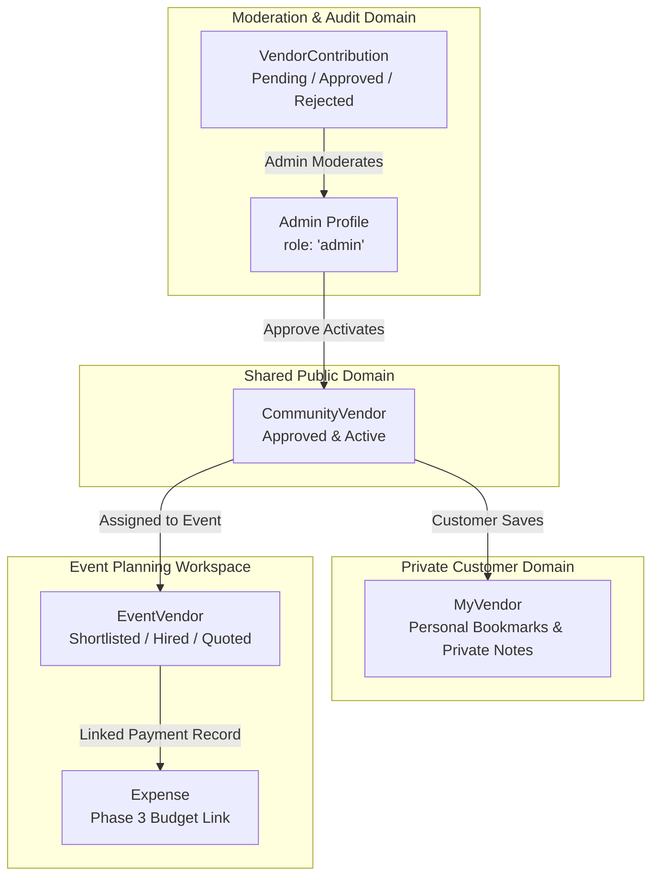

# Community Vendor Recommendation System Specification

## 1. System Overview & Philosophy

The **Community Vendor Recommendation System** in EventPilot AI is a shared, crowd-contributed vendor discovery and evaluation directory designed specifically for event and celebration planners.

### Strict Non-Marketplace Boundary
EventPilot AI is **NOT a marketplace**:
- **No vendor accounts, logins, or portal access**: Vendors cannot register, log in, manage listings, or set up profiles.
- **No in-platform booking or checkout**: Customers contact service providers independently via phone, email, and websites.
- **No commission or payment processing**: No escrow, deposits, transaction fees, or payout gateways.
- **No live vendor calendars or messaging**: No real-time chat with vendors or vendor-controlled availability.

Customers independently discover, evaluate, contact, and negotiate with vendors. They contribute verified business information and review data to assist fellow event planners.

---

## 2. Architectural Data Domains



1. **Shared Community Vendors (`community_vendors`)**:
   - Approved, public service provider records.
   - Includes business name, category, location, contact coordinates, service areas, and pricing models.
   - Read-accessible by all users and prospective customers.

2. **Customer Contributions (`vendor_contributions`)**:
   - Private submission records tracking the contributing user, relationship type, source description, private review notes, and consent acknowledgement.
   - Moderated by administrators (`role: 'admin'`).

3. **Customer Saved Vendors (`my_vendors`)**:
   - Personal vendor bookmarks saved across events.
   - Private personal notes per saved vendor bookmark.

4. **Event Vendor Workspace (`event_vendors`)**:
   - Specific assignments to an event celebration.
   - Tracks hiring status (`shortlisted`, `contacted`, `quoted`, `hired`, `rejected`) and contact status.
   - Tracks estimated cost vs actual cost and links optionally to Phase 3 `Expense` vouchers.

---

## 3. Deterministic Recommendation Engine

The recommendation engine scores community vendors against event requirements deterministically (0 to 100 points) without relying on external LLM services:

| Factor | Points | Evaluation Rule |
| :--- | :---: | :--- |
| **Category Match** | **40** | Vendor category matches requested celebration category (e.g., Catering, Photography, Venue) |
| **City Match** | **25** | Vendor city matches celebration location city |
| **Service Area Match** | **15** | Vendor service area list includes celebration location city (or awarded if city matches directly) |
| **Event Type Match** | **10** | Vendor's supported celebration types include event type (e.g., Wedding, Birthday, Corporate) |
| **Budget Compatibility** | **10** | Vendor's starting price is within the event's category allocation or total event budget |
| **Total Score** | **100** | Scaled deterministic match percentage |

### Transparent Match Reasoning
Responses include detailed score factor breakdowns and human-readable explanation strings, explaining exactly why each vendor was recommended.

---

## 4. Duplicate Detection Engine

When a customer submits vendor information, the duplicate engine evaluates:
1. **Phone Number Match**: Normalizes phone digits (last 10 digits) -> **95% Confidence**.
2. **Website Domain Match**: Strips protocol, `www.`, and URL path -> **90% Confidence**.
3. **Exact Name & Same City Match**: Normalizes name (removes punctuation, suffixes like "pvt ltd", "events", "caterers") -> **92% Confidence**.
4. **Similar Name in Same City**: Substring/fuzzy match -> **75% Confidence**.

Advisory warnings are returned to the client to prevent fragmented duplicate entries.

---

## 5. Admin Moderation Workflow

Administrators (`Profile.role === 'admin'`) have secure access to `/api/admin/vendor-contributions`:
- **List Pending**: View queue of customer submissions with submitter details.
- **Approve**: Sets `VendorContribution.reviewStatus = 'approved'`, sets `CommunityVendor.status = 'approved'`, logs `reviewedBy` and `reviewedAt`.
- **Reject / Suspend**: Sets review status, records administrative review notes, and deactivates the vendor listing.

---

## 6. Supabase PostgreSQL Deployment Command

To apply the Phase 4 database migration to your Supabase PostgreSQL database, execute:

```bash
npx prisma db execute --file ./prisma/migrations/20261031_phase4_community_vendors/migration.sql --schema ./prisma/schema.prisma
```
*(Run from the `backend/` directory)*

